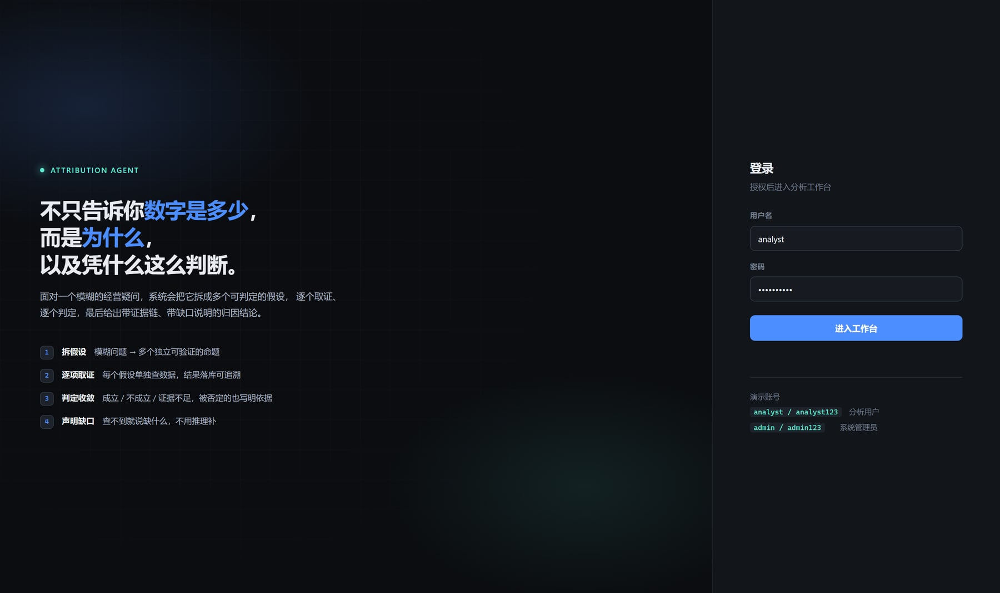
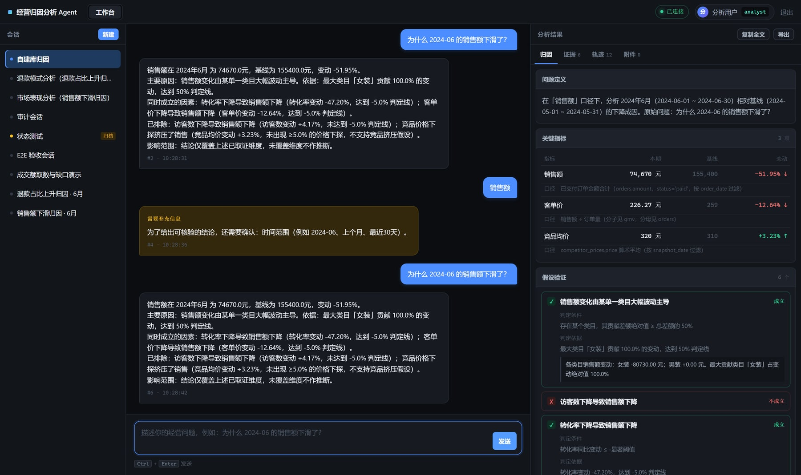

# 经营归因分析 Agent

面向经营分析场景的**多轮归因分析系统**：围绕一个业务问题持续追问、补充证据、生成阶段性结论与可核验的归因报告。

需求基线：《项目实战》2.1 经营归因分析系统（全量对齐，见 `docs/SPEC-经营归因分析Agent.md`）。

> **一句话**：它回答的不是"数字是多少"，而是"**为什么**，以及**凭什么**这么判断"。

---

## 30 秒跑起来

```bash
# 1. 环境（Python 3.12+）
python -m venv .venv
.venv\Scripts\activate          # Windows
# source .venv/bin/activate     # macOS / Linux

# 2. 依赖
pip install -r requirements.txt

# 3. 初始化（生成示例数据 + 演示账号）
python scripts/init_db.py --force

# 4. 启动
python -m uvicorn app.main:app --host 127.0.0.1 --port 8123
```

打开 http://127.0.0.1:8123

| 账号 | 密码 | 角色 |
| --- | --- | --- |
| analyst | analyst123 | 分析用户 |
| admin | admin123 | 系统管理员 |



---

## 它解决什么

| 维度 | 单轮问数 | 本项目 |
| --- | --- | --- |
| 输入 | 一个明确的取数问题 | 一个**模糊的因果疑问** |
| 交互 | 单轮 | **多轮追问、补充证据** |
| 工具 | 一条 SQL | 按假设需要动态选择查询/文件/检索/命令 |
| 输出 | 一个结果集 | **结论 + 逐条证据 + 缺口 + 下一步** |
| 缺数据 | 报错或无结果 | **显式声明缺什么，不用推理补** |

核心是**假设—取证—收敛**循环：

```
模糊问题 → 拆成可判定假设 → 逐个取证 → 判定(成立/不成立/证据不足) → 收敛结论 → 声明缺口
```

**这个循环是本项目的全部价值。** 若退化成"一条 SQL + 一段总结"，则与单轮问数无异（SPEC 中 FR-5.11 专门用于防止这种退化，对应测试 AC-19）。

### 看效果

问「为什么 2024-06 的销售额下滑了？」，实际输出 6 个假设：

| 判定 | 假设 | 依据 |
| --- | --- | --- |
| ✓ 成立 | 销售额变化由某单一类目主导 | 服饰鞋包贡献 74.9% 的变动 |
| ✓ 成立 | 转化率下降导致销售额下降 | 转化率 -20.11% |
| ✗ 不成立 | 访客数下降导致销售额下降 | 访客数实际 **+2.74%**（上涨） |
| ✗ 不成立 | 客单价下降导致销售额下降 | 客单价实际 **+10.63%**（上涨） |
| ✗ 不成立 | 竞品价格下探挤压了销售 | 竞品均价仅 -1.12% |
| ✗ 不成立 | 退款占比上升侵蚀了销售额 | 未达显著阈值 |

**"不成立"不是我预埋的**——数据里这些维度本来就没变化，Agent 去查了才发现。




## 验证与测试命令

上面跑起来之后，这些命令可以验证各项工作（都需要服务在跑，除非注明）：

```bash
python -m pytest tests/ -q               # 108 条单测 + 接口测试
python scripts/e2e.py                    # 真实 HTTP 端到端验收（34 项）
python scripts/audit_spec.py             # 2.1 原文逐条审计（49 项）
python scripts/demo.py                   # 两个业务场景完整链路
python scripts/demo_datasource.py        # 数据源接入实测
python scripts/check_data.py             # 核对示例数据形态（无需服务）
python scripts/probe_engine.py           # 直接看分析引擎产出（无需服务）
python scripts/reset_demo.py             # 清理验收产生的噪音会话
```

一键全套（自动用隔离库，不碰演示数据）：

```bash
python scripts/verify_all.py
```

| 账号 | 密码 | 角色 |
| --- | --- | --- |
| analyst | analyst123 | 分析用户 |
| ops | ops123 | 分析用户 |
| admin | admin123 | 系统管理员 |

### 试试这几个问题

| 提问 | 预期行为 |
| --- | --- |
| `销售额` | 触发澄清：要求补充时间范围，**不猜** |
| `2024-06 的销售额` | 取数对照，**不生成归因假设** |
| `为什么 2024-06 的销售额下滑了？` | 6 个假设，2 个成立 4 个被排除 |
| `为什么 2024-06 的退款占比上升了？` | 4 个假设，集中度与分母效应成立 |
| `为什么 2019-01 的销售额下滑了？` | 指出该区间不在数据覆盖范围内 |

### 验证

```bash
# 单元 + 接口测试（63 条）
python -m pytest tests/ -q

# 真实 HTTP 端到端验收（34 项）
python scripts/e2e.py

# 两个业务场景的完整演示链路
python scripts/demo.py

# 核对示例数据形态（不依赖 Agent）
python scripts/check_data.py

# 直接看分析引擎产出（绕过接口层）
python scripts/probe_engine.py
```

---

## 示例数据

数据覆盖 **2024-04 ~ 2024-06**，六个场景的表全部建立：

| 场景 | 主要表 |
| --- | --- |
| 市场表现分析（主链路） | orders、traffic_daily、traffic_channel、ad_spend、competitor_prices、promotion_daily、sales_summary |
| 退款模式分析（主链路） | refunds、refund_reasons、refund_requests、orders |
| 商品目录优化 | products、categories、search_exposure、conversion_daily |
| 客户行为分析 | visitors、visitor_events、cart_events、order_events |
| 库存异常分析 | inventory、inbound、outbound、sales_daily |
| 评论反馈分析 | comments、ratings、reviews |

**数据生成纪律**（SPEC FR-11.3~11.5）：

- 维度齐全 → Agent 才有料可查，能提出多个假设
- **不预埋假线索** → 假设成立与否由数据本身决定，不是出题

数据里的真实变化：2024-06 中旬起「服饰鞋包」类目转化率下滑、退款率抬升，同期竞品价格**没有**下探、访客数**上涨**、客单价**上升**。所以"竞品挤压""流量下滑""客单价下滑"三个假设会被数据自然否定——这不是我埋的陷阱，是这些维度本来就没变化。

---

## 关键设计

### 1. 澄清优先，不猜

缺分析对象或时间范围时，直接提问并持久化断点（`analysis_session_states`），补充后继续，无需重复描述背景。

### 2. 证据必须可追溯

每次取数都经过工具层并落 `tool_invocations`。结果中的每条证据带 `source_type` / `source_name` / `confidence`，每个指标带 `definition`（口径）。给定指标记录能复现同一数值。

### 3. 置信度由规则产生

```
有反驳性证据        → 低
直接指标 + 样本≥100 → 高
其余                → 中
```

不由模型断言（FR-6.5）。

### 4. 缺口显式声明

假设判不了时说清"缺什么数据"，列入「待补充数据」。**不用推理或常识补全后当结论**（FR-5.10）。

### 5. 工具执行边界

| 工具 | 边界 |
| --- | --- |
| 数据库查询 | 只读；拒绝非 SELECT；单次上限 1000 行；业务库以 `mode=ro` 打开，绕过应用层也无法写 |
| 文件读写 | 限 `workspace/{user}/{conv}/`；拒绝 `..`、绝对路径逃逸 |
| 命令执行 | 白名单（python/ls/cat/head/grep/wc 等）；超时 10s；输出上限 4000 字符 |
| 文本检索 | 限已上传附件 |
| 结果导出 | 限 `exports/{user}/{conv}/` |

### 6. 单会话单任务

由数据库**部分唯一索引**强制（`task_status='running'` 时 `conversation_id` 唯一），不靠应用层 if。

### 7. 拒绝路径有计数器

`/api/admin/rejections` 可查所有拒绝码的触发次数。**计数器为 0 的拒绝路径视为未验证**（NFR-2）。

---

## 目录

```
attribution_agent/
├── app/
│   ├── config.py              配置与热更新（含默认值兜底）
│   ├── db.py                  数据模型与硬约束
│   ├── api.py                 HTTP + WebSocket
│   ├── auth/session.py        登录态与角色
│   ├── analysis/
│   │   ├── metrics.py         指标口径、周期解析、覆盖区间探测
│   │   ├── hypotheses.py      假设与判定、置信度规则
│   │   ├── engine.py          假设—取证—收敛主循环
│   │   ├── runner.py          任务编排、落库、摘要、级联删除
│   │   └── sample_data.py     六场景示例数据
│   ├── tools/registry.py      五类工具与执行边界
│   └── web/templates/         登录页、工作台
├── scripts/                   init_db / e2e / demo / check_data / probe_engine
├── tests/                     63 条测试，用例名对应 AC 编号
└── data/                      app.db / business.db / storage/
```

---

## 需求覆盖审计

按《项目实战》2.1 原文逐节核对，**49 项全部符合，0 项部分符合，0 项未实现**。可复现（先启动服务）：

```bash
python -m uvicorn app.main:app --port 8123   # 终端 1
python scripts/audit_spec.py                 # 终端 2
```

| 原文章节 | 覆盖情况 |
| --- | --- |
| 2.1.1 基础能力 | 认证、会话、附件、配置热更新、运行日志：**全实现** |
| 2.1.1 分析能力 | 数据库查询 / 文件读写 / 文本检索 / 命令执行 / 结果文件生成：**五类工具全部真实参与取证**（见下方"曾经的打折项"） |
| 2.1.2 用户角色 | 分析用户 + 管理员，管理员能力对分析用户返回 403 |
| 2.1.2 管理员职责 | **五项逐条实现**：认证配置（用户管理）、系统配置、运行日志、**数据源连接**、**功能开关** |
| 2.1.3 页面需求 | 登录页、回调、工作台、附件侧栏、实时任务区、结果区（含六部分） |
| 2.1.4 会话与任务规则 | 三种会话状态、五种任务状态、单任务约束、消息顺序、删除级联、长连接 |
| 2.1.5 前端模块 | 7 个模块均在 `app.js` 中实现 |
| 2.1.6 后端模块 | 8 个模块均在 `app/` 下实现 |
| 2.1.7 数据表 | 10 张表全部建齐，关键约束落库 |
| 2.1.8 文件存储 | uploads / exports / workspace 三目录，删除时清空 |
| 2.1.9 接口 | 15 个接口全部提供 |
| 2.1.10 实时消息 | 8 类消息，实测捕获 7 类（`error` 仅在失败时发出） |
| 2.1.11 输出格式 | 六部分 + 字段完整性 + 建议 ≥2 条 |
| 2.1.12 示例场景 | 六场景表全部建立，两个场景跑完整链路 |
| 2.1.13 验收标准 | 8 条逐条对应 |

### 曾经的打折项（已修复，附证据）

第一版交付时这些是打折的，审计时被抓出来并修复：

| 项 | 当时状态 | 现在 |
| --- | --- | --- |
| 分析能力只剩 db_query | 文件读写/文本检索/命令执行三个工具**实现了但引擎从不调用**，等于只有壳 | 新增 `analysis/router.py` 按问题选工具，实测一次分析会调用 `text_search` / `file_write` / `command_run`；测试 `test_tool_chain.py` 卡住回归 |
| `message_delta` 从未发送 | 8 类消息缺 1 类 | 按段落推送真实增量文本，实测捕获 |
| 会话 `archived` 状态 | 只有 active/deleted | 支持归档与恢复，可查可切 |
| 上下文摘要只生成不读回 | 生成了但后续分析不用 | 摘要作为前序上下文注入分析 |
| 配置/日志无页面入口 | 只有 API | 新增配置页（14 项，可改可重载）、日志页（级别筛选） |
| 附件侧栏缺上传时间 | 少一个字段 | 已补 |
| **结果区复制功能缺失** | 2.1.3 要求"支持复制和导出"，重写前端时把复制弄丢了，只剩导出 | 补三处复制：复制全文（拼六部分纯文本，实测 1193 字）、复制证据、复制结论；含非安全上下文回退 |

### 交付期抓到的真实缺陷（非需求折扣，是 bug）

| 缺陷 | 现象 | 根因 | 修法 |
| --- | --- | --- | --- |
| **连接池耗尽** | 管理员打开工作台 500 `QueuePool limit of size 5 reached` | `get_session` 直接当依赖用，会话从不 close；分析线程+WS+页面并发时占满池 | 改为 `session_dep` 生成器依赖，请求结束必定归还；池放宽到 20+40 |
| **删除会话 FK 报错** | 签发过 WS 令牌的会话删不掉 | 级联删除漏了 `websocket_tokens` | 补齐该表 + 未绑定 task 的日志；加 2 条测试 |
| **迁移缺失** | 升级后 500 `no such column: tool_plan_json` | `create_all` 不给已存在的表补列 | 加轻量迁移 `_migrate_add_columns()` |
| **缺失≠零** | 越界区间被判成"业务归零" | `COALESCE` 把无记录变成 0 | 先查原始记录数，0 条返回 None |
| **假设同义反复** | 用"退款占比上升"解释"退款占比上升" | 假设设计错误 | 换成集中度/单笔金额/分母效应三个独立维度 |

---

## 前端

深色数据工具风格。**分析用户**两个视图，**管理员**六个视图：

| 视图 | 谁能看 | 内容 |
| --- | --- | --- |
| 工作台 | 全部 | 左：会话（重命名/归档/删除）；中：对话 + 实时任务条；右：结果四标签（归因 / 证据 / 轨迹 / 附件） |
| 数据源 | 管理员 | 登记/测连通/探查结构/切换/删除。探查会明确报出缺哪些表、对哪类分析有影响 |
| 用户 | 管理员 | 建用户、重置密码、改角色、启停账号 |
| 配置 | 管理员 | 6 个功能开关 + 数值参数，重载即时生效并回显变更前后差异 |
| 运行日志 | 管理员 | 按级别筛选，显示任务归属 |
| 拒绝计数 | 管理员 | 每个拒绝码的触发次数；虚线框=计数为 0，表示该路径从未被验证 |

### 数据源怎么接自己的库

管理员登录 → 顶部「数据源」→ 登记数据源 → 填 SQLite 文件路径 → 保存并测试 → 探查结构 → 设为当前。

要点：

- **只支持 SQLite**。MySQL/PG 需要另写适配器（`datasource.py` 留了 `kind` 字段但只实现了 sqlite）
- 默认**只读打开**，分析不会改你的库
- **第一个登记的数据源会自动激活**，避免"加了但没生效"
- 缺表不会报错，但对应假设会判「证据不足」——探查页会列清缺什么、影响哪类分析
- 删除激活中的数据源会自动回落到内置示例库（不会死锁）

需要的最小表集：

```
orders / products / categories / traffic_daily /
refunds / reviews / inventory / competitor_prices
```

实测脚本：

```bash
python scripts/demo_datasource.py
```

它会自造一个库（女装 6 月断崖下滑、男装持平、竞品涨价），登记 → 探查 → 切换 → 分析，最后校验**读的确实是新库**（74670 元而非示例库 383 万）。

### 功能开关

| 开关 | 关闭后 |
| --- | --- |
| `enable_attachment` | 无法上传附件，附件不进入证据链 |
| `enable_command_tool` | 分析中不能执行命令 |
| `enable_file_tools` | 不能读写中间文件 |
| `enable_text_search` | 不从附件检索证据 |
| `enable_context_summary` | 不生成会话摘要 |
| `enable_export` | 结果只可复制，不可导出文件 |

**关掉的开关会在结果里说明**（`degraded_note` 字段），不会静默失效。

### 截图

`shots/` 下 17 张，覆盖登录、工作台各标签、管理员各页：

| 文件 | 内容 |
| --- | --- |
| `01-login.jpg` | 登录页 |
| `02-workbench-empty.jpg` | 空工作台 |
| `03-clarify.jpg` | 澄清轮（缺条件时追问） |
| `04-result.jpg` | 完整归因结果（六部分） |
| `05-evidence.jpg` | 证据列表（含置信度与类型） |
| `06-trace.jpg` | 工具调用轨迹（每步查的是哪个指标哪个周期） |
| `07-files.jpg` | 附件管理 |
| `08-config.jpg` / `09-logs.jpg` / `10-counters.jpg` | 管理员：配置 / 日志 / 计数器 |
| `11-copy.jpg` | 复制与导出验证 |
| `12-sources-empty.jpg` | 数据源页（空状态） |
| `13-sources-form.jpg` | 登记数据源表单 |
| `14-sources-inspect.jpg` | 结构探查结果（缺表影响清单） |
| `15-users.jpg` | 用户管理 |
| `16-users-created.jpg` | 新建用户后 |
| `17-config-switches.jpg` | 功能开关区 |

重新生成需要**隔离实例**，避免污染演示数据：

```bash
# 隔离实例
ATTR_DATA_DIR=./data_shot python scripts/init_db.py --force
ATTR_DATA_DIR=./data_shot python -m uvicorn app.main:app --port 8126

# 截图（另一个终端）
python scripts/make_demo_source.py
BASE=http://127.0.0.1:8126 node scripts/shoot.js
BASE=http://127.0.0.1:8126 node scripts/shoot_admin.js
BASE=http://127.0.0.1:8126 node scripts/shoot_sources.js
```

---

## 边界声明

**明确未做的**（不得以"已实现"措辞描述）：

| 项目 | 实际做法 |
| --- | --- |
| 真实第三方认证中心 | 本地认证服务，保留"入口页→回调换令牌→登录态"的形态，接口可替换 |
| PDF 文本抽取 | 未启用；上传 PDF 会标 `parse_status=failed` 并记录原因，不参与证据 |
| 多租户、计费、高可用 | 未做，单实例运行 |
| LLM 生成假设 | 当前假设由**规则引擎**按维度生成，保证可复现；LLM 接入为预留的适配层（`config.generation_source`），未启用 |
| 写入业务数据库 | 明确只读，业务库以 `mode=ro` 打开 |

**为什么不接 LLM 生成假设**：本项目要在面试里能答"同一个问题问两次，结论为什么一致"。规则引擎可以保证；模型生成不能。接入 LLM 会让"假设为什么这么拆"变成不可解释的黑盒。

---

## 已知短板

1. **假设集合是预定义的**。按指标维度枚举假设，不是自由推演。好处是可复现、可测；代价是遇到预定义之外的因果关系查不出来。这是有意取舍，不是遗漏。
2. **周期解析只支持常见表述**（`2024-06`、`上个月`、`最近30天`），复杂表述会走澄清。
3. **指标口径固定在代码里**，不支持用户自定义指标。
4. **上下文摘要用模板拼接**，不是模型压缩，长会话的摘要质量有限。

---

## 测试与 AC 对应

| 测试文件 | 覆盖 |
| --- | --- |
| `test_tool_boundaries.py` | AC-11 只读、AC-12 命令白名单/超时/截断/静默失败、AC-13 路径穿越 |
| `test_analysis.py` | AC-19 防退化、AC-9 澄清、AC-10 缺口与证据可追溯、AC-5 六部分结果 |
| `test_api.py` | AC-1 认证、AC-2 会话、AC-3 附件、AC-5/6 结果与导出、AC-7 配置、AC-14 单任务、AC-15 级联删除、AC-16 WS 令牌、NFR-2 计数器 |
| `scripts/e2e.py` | 34 项真实 HTTP 验收（非打桩） |
| `scripts/demo.py` | AC-8 两个业务场景完整链路 |
